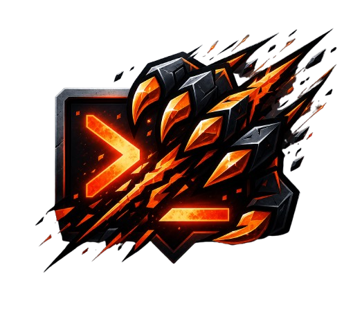

  
  <h1>🔥 Commit Furioso</h1>
  
<em>Onde todo problema vira projeto.</em>

  
  
  
  
  

---

## 💻 Sobre a Equipa
Nascemos num ambiente académico de alta exigência e adotamos a filosofia de que nenhum bug sobrevive a um *commit furioso*. Unimos metodologias ágeis e práticas sólidas de engenharia de software para entregar soluções de alto impacto.

## 👨‍💻 Membros & Funções

| Nome | Função Principal |
| :--- | :--- |
| **Luiz Filipe** | Product Owner (P.O) |
| **Nicolas Miranda** | Scrum Master |
| **Davi Sandro Dos Santos** | Desenvolvedor Full Stack |
| **Vitória Nunes** | Desenvolvedora |
| **Leonardo Cabral Primos** | Quality Assurance (QA) |

## 🎓 Base Académica & Competências
A nossa robustez técnica provém de uma trajetória contínua (2025–2026). As nossas soluções são suportadas pelos seguintes pilares da Ciência da Computação:

*   **Engenharia & Arquitetura:** Engenharia de Software, Análise e Projeto de Sistemas, Programação Orientada a Objetos (POO), Sistemas Cliente/Servidor, Interface Humano-Computador.
*   **Lógica & Estruturas de Dados:** Estruturas de Dados I e II, Técnicas de Desenvolvimento de Algoritmos, Lógica Computacional, Pensamento Computacional.
*   **Infraestrutura & Dados:** Banco de Dados, Modelagem de Dados, Redes de Computadores, Sistemas Operacionais, Organização e Arquitetura de Computadores.
*   **Desenvolvimento Web:** Programação Web, Aplicações para Internet.
*   **Base Analítica & Negócios:** Cálculo (I e II), Probabilidade e Estatística, Estruturas de Mercado e Tomada de Decisão.

## 🏆 Projetos em Destaque
- 📦 [**Sistema de Gestão de Produção (Árvore Genérica)**](https://github.com/Commit-Furioso/ProjetoArvoreA2) — Aplicação desenvolvida para cálculo de fórmulas de produção, explosão de materiais e implosão de custos (CRUD dinâmico com persistência), suportando múltiplos produtos (Caneta, Computador e Avião) utilizando Árvores N-árias em Java Spring Boot.  
  * [🌐 Aceder ao Sistema Live](https://projetoarvorea2.onrender.com/)

- 🌳 [**Sistema de Solicitações (Árvore AVL)**](https://github.com/Commit-Furioso/avl-sistema-solicitacao) — Aplicação Web Fullstack com balanceamento dinâmico de nós em tempo real no backend.   
  * [🌐 Aceder ao Sistema Live](https://avl-sistema-solicitacao.onrender.com/)

---

  <i>Forged in #0D0A0F (Preto Profundo) & #E14017 (Laranja Fogo)</i>

